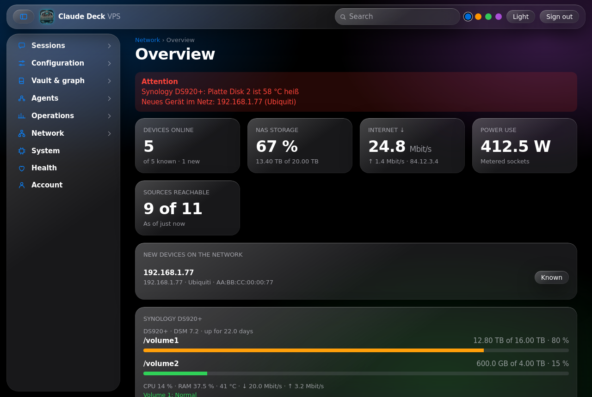
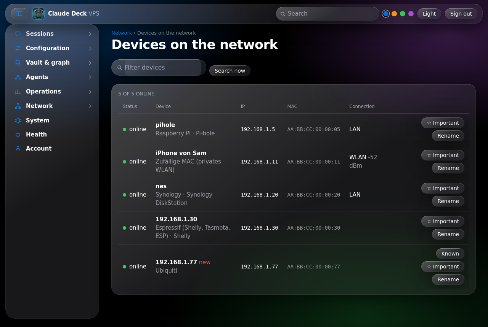
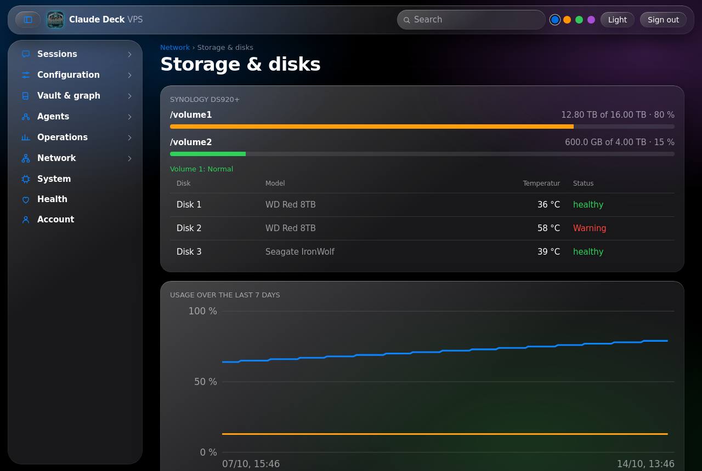
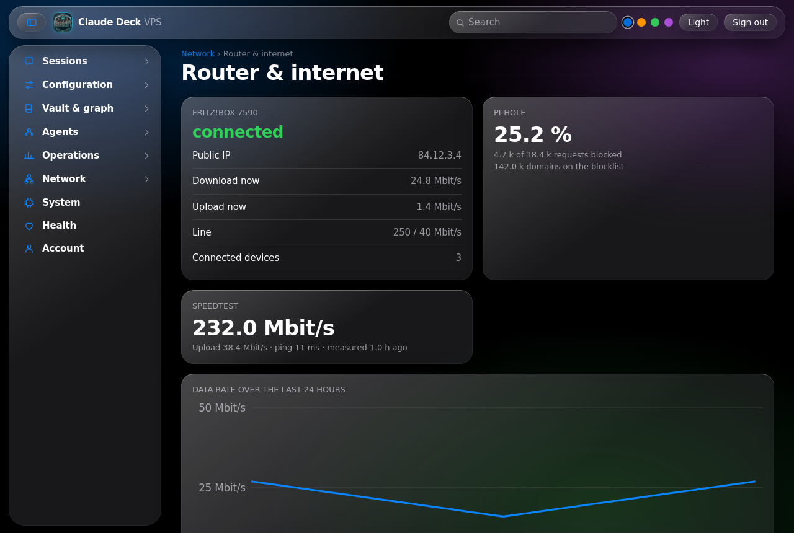
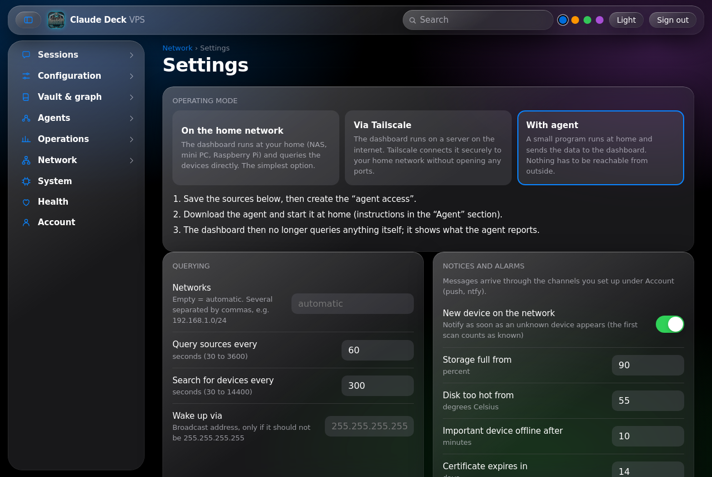

# Claude Deck

**One self-hosted dashboard for your Claude Code sessions and your home network.**

Claude Deck runs on a server you own and shows what Claude Code is doing (sessions, usage limits, costs, system health) and, new in 1.4, what is happening on your network: which devices are online, how full your NAS is, how your router and internet line behave. It warns you before a limit runs out or a disk fills up, and works as an installable phone app.

  

<table>
<tr>
<td width="50%"><br><sub>Network overview</sub></td>
<td width="50%"><br><sub>Devices on your network</sub></td>
</tr>
<tr>
<td><br><sub>NAS storage, disks and the "full in N days" forecast</sub></td>
<td><br><sub>Router and internet</sub></td>
</tr>
</table>

## Why

- **Small footprint.** Python standard library plus one dependency-free `index.html`. No build step, no database, no npm.
- **Reads what is already there.** Claude Code writes its session logs to `~/.claude/projects/` and its usage cache to `~/.claude.json`; no API token is needed. Network devices are read through SNMP, SSH or their own interfaces.
- **Three ways to reach your home network.** Run the dashboard at home, run it on a server and connect through Tailscale, or run a tiny agent at home that pushes data. You choose in the settings.
- **Works for almost any NAS and router.** SNMP, SSH and the agent cover nearly everything; 24 source types add vendor details.
- **Phone friendly.** Home-screen app, Web Push, layout tuned for modern iPhones, German and English.
- **Careful with power.** Everything that changes something needs a fresh password and 2FA code and lands in an audit log.

> **Security first.** The optional remote-control features can start sessions, edit Claude settings and run `tmux` commands on the host, and the original setup runs as root. Read [Security](#security) before you expose this to the internet.

## Contents

- [Quick start](#quick-start)
- [Features](#features)
- [Requirements](#requirements)
- [Installation](#installation)
- [Configuration](#configuration)
- [Network](#network)
- [Server: firewall and Docker](#server-firewall-and-docker)
- [FTP browser](#ftp-browser)
- [Server file browser](#server-file-browser)
- [Notifications](#notifications)
- [Install as a phone app (iOS and Android)](#install-as-a-phone-app-ios-and-android)
- [Limits and automatic reset](#limits-and-automatic-reset)
- [Languages](#languages)
- [Security](#security)
- [Project layout](#project-layout)
- [Tests](#tests)
- [Known limitations](#known-limitations)

## Quick start

On a Linux machine where Claude Code already runs for your user:

```bash
git clone https://github.com/melcher535-cmd/claude-deck-dashboard.git /opt/claude-deck && cd /opt/claude-deck
cp .env.example .env && nano .env      # set DECK_PASSWORD (12+ characters) and DECK_DOMAIN
set -a; . ./.env; set +a && python3 server.py
```

Then open an SSH tunnel (`ssh -L 8770:127.0.0.1:8770 you@your-server`) and browse to `http://127.0.0.1:8770`. Before first use adapt a few paths and set up a service and HTTPS: the [Installation](#installation) walks through it step by step, with a check after every step.

## Features

**Claude Code: sessions and usage**
- Overview with 5-hour and weekly limits (ring gauges), running sessions with a live activity ticker and context size estimate
- History, models, projects, tools, cost estimate (tokens, not money), 26-week activity heatmap, work-time Gantt chart
- Usage history with a forecast ("full in about N hours"), consumption share per session, error patterns
- Chat view per session (messenger style, coloured diffs for edits), filters, Markdown export, session compare
- Pin sessions with a note, copy `claude --resume <id>`
- **Custom widgets** on the overview: Customize → *Widget hinzufügen*. Pick one of 36 sources, a look (number, ring, line, bars, list), a range and a width, with a live preview. In *Anpassen* mode the widgets wiggle like on the iPhone: grab one by its header bar and drag it. Widgets and their order are stored on the server (`widgets.json`) and apply on every device

**Network** (details in [Network](#network))
- Pages for devices, NAS storage and disks, router and internet, services and accessories; 13 matching overview widgets
- Device list with vendor and type guess, new-device alert, Wake-on-LAN, important-device watch
- NAS volumes with a **"full in about N days"** forecast, disk temperature, SMART and RAID state
- Router rate, public IP, ad-blocker statistics, UPS, smart sockets, certificate expiry, backup age, speed test
- 30-day history, alarms through ntfy and Web Push

**Server** (details in [Server: firewall and Docker](#server-firewall-and-docker))
- Firewall (ufw): rules, listening ports and whether the firewall lets them through, with a 60 second **rollback timer** and protection against locking yourself out
- Docker: create, start, stop and delete containers from a form or a template, logs, CPU and memory, images
- Files: browse the server's disk, download, upload, rename, delete (see [Server file browser](#server-file-browser))
- FTP: browse saved FTP servers, download, upload, create folders and delete (see [FTP browser](#ftp-browser))

**Notifications**
- Warnings at 80 % and 95 % of a limit, a forecast warning, a message when a limit **resets** and when a watched session finishes
- Network alarms: new device, full volume, hot disk, degraded RAID, source down, internet down, UPS on battery, certificate close to expiry, missing backup
- Daily summary at 20:00 (Europe/Berlin), alert after repeated failed logins
- Channels: [ntfy.sh](https://ntfy.sh) and Web Push (RFC 8030 / 8291 / 8292)

**Vault and notes** (optional, needs an Obsidian vault and a graph file written by graphify)
- Interactive graph (drag, zoom, tap), note reader with full-text search, vault tree and health checks
- Create a note from a chat (asks first, never overwrites)

**System and operations**
- CPU, RAM, disk, service overview, certificate expiry, journal errors, provider status
- Local git repositories overview, GitHub issues via `gh` (if installed and logged in)
- Backups of the dashboard and your Claude settings, with partial restore

**Remote control** (every action needs a fresh password and 2FA code and is written to an audit log)
- View and operate `tmux` sessions, start and stop `deck-` sessions and teams
- Edit `settings.json`, permissions and hooks (diff preview and automatic backup), add and remove MCP servers

**Account**
- Login form, rate limiting (5 failures, then a 15-minute lock per IP), "stay signed in" for 30 days
- Change password in the dashboard (scrypt hash), TOTP two-factor with QR code, access log
- Language switch (German, English), light and dark theme, accent colours, Liquid-Glass inspired design, keyboard shortcuts (`?`, `/`, `Ctrl+K`)

## Requirements

- Linux with Python 3.9 or newer (uses `zoneinfo`)
- Python package `cryptography` (only needed for Web Push; the rest is standard library)
- Claude Code installed for the same user that runs the dashboard
- A reverse proxy with HTTPS if you want to reach it from outside (Caddy is shown below)
- Optional: `tmux`, `git`, `gh`

## Installation

A complete walk-through for a fresh Ubuntu or Debian server where Claude Code already runs. Commands assume a user with `sudo`; drop `sudo` if you are root. Every step has a check so you know it worked.

### 1. Check the prerequisites

```bash
python3 --version     # 3.9 or newer
claude --version      # Claude Code must be installed for THIS user
ls ~/.claude/projects # should list at least one project folder
```

If `claude` is missing, install Claude Code first (https://claude.com/claude-code) and start it once so that `~/.claude` exists. Note the full path of the binary, you need it in step 4:

```bash
which claude          # for example /home/you/.local/bin/claude
```

### 2. Install the system packages

```bash
sudo apt update
sudo apt install -y git python3 python3-cryptography tmux
```

`tmux` and `git` are only used by the optional views. `python3-cryptography` is required for Web Push. If you prefer pip: `pip install cryptography`.

### 3. Get the code

```bash
sudo mkdir -p /opt/claude-deck
sudo chown "$USER": /opt/claude-deck
git clone https://github.com/melcher535-cmd/claude-deck-dashboard.git /opt/claude-deck
cd /opt/claude-deck
```

### 4. Adapt the paths to your server

The defaults belong to the original server (user `root`). Open `server.py` and change these lines (use `grep -n` to find them if the line numbers moved):

| Line | Default | Set it to |
|---|---|---|
| `VAULT = ...` (line 33) | `/root/Obsidian-sync` | Your Obsidian vault, or any existing folder if you have none |
| `BACKUP_DIR = ...` (line 594) | `/root/deck-backups` | A folder the service user may write to, for example `/home/you/deck-backups` |
| `claude_bin=...` (line 600) | `/root/.local/bin/claude` | The output of `which claude` |
| `roots=[...]` (line 600) | `["/root"]` | The folders in which remote control may start sessions, for example `["/home/you"]` |
| glob `/root/*backup*` (line 523) | `/root` | Your home folder (only affects the backup list) |

Quick check that nothing personal is left:

```bash
grep -n "/root" server.py
```

### 5. Set the password

```bash
cp .env.example .env
nano .env             # set DECK_PASSWORD
chmod 600 .env
```

Add your public host name as `DECK_DOMAIN=deck.example.com`. Use at least 12 characters. If the value contains `&`, `$` or spaces, wrap it in single quotes: `DECK_PASSWORD='my&pass word'`. Add `DECK_NTFY_TOPIC=<unguessable-name>` now if you want ntfy messages (see [Notifications](#notifications)).

### 6. Test run in the foreground

```bash
set -a; . ./.env; set +a
python3 server.py
```

The process prints nothing when it works and stays in the foreground. In a second terminal check it:

```bash
curl -si http://127.0.0.1:8770/ | head -1     # HTTP/1.0 303 See Other (redirect to the login page)
```

To look at it from your own computer, open an SSH tunnel and browse to `http://127.0.0.1:8770`:

```bash
ssh -L 8770:127.0.0.1:8770 you@your-server
```

The login cookie is marked `Secure`. Chrome and Firefox accept it on `127.0.0.1`; Safari may not, so finish steps 7 to 9 and use HTTPS for daily use. Stop the test with `Ctrl+C`.

### 7. Run it as a service

Create `/etc/systemd/system/claude-deck.service` (replace `you` with the user from step 1):

```ini
[Unit]
Description=Claude Deck Dashboard
After=network.target

[Service]
User=you
WorkingDirectory=/opt/claude-deck
EnvironmentFile=/opt/claude-deck/.env
ExecStart=/usr/bin/python3 /opt/claude-deck/server.py
Restart=always
RestartSec=3
NoNewPrivileges=true

[Install]
WantedBy=multi-user.target
```

```bash
sudo systemctl daemon-reload
sudo systemctl enable --now claude-deck
systemctl is-active claude-deck               # active
journalctl -u claude-deck -n 20 --no-pager    # look for errors
```

The service must run as the user whose `~/.claude` it should read; that is why `User=` is set. It restarts on crashes and at boot.

### 8. Point a domain at the server and add HTTPS

1. At your DNS provider create an `A` record, for example `deck.example.com`, with your server's public IP.
2. Install Caddy by following https://caddyserver.com/docs/install (official package repository for Debian and Ubuntu).
3. Put this in `/etc/caddy/Caddyfile` (same host name as `DECK_DOMAIN` in step 5):

```caddyfile
deck.example.com {
	reverse_proxy 127.0.0.1:8770
}
```

```bash
sudo systemctl reload caddy
```

Caddy requests and renews the Let's Encrypt certificate by itself. This needs ports 80 and 443 to be reachable from the internet.

### 9. Close everything else with the firewall

```bash
sudo ufw allow 22/tcp
sudo ufw allow 80/tcp
sudo ufw allow 443/tcp
sudo ufw enable
sudo ufw status
```

Allow SSH **before** you enable the firewall, or you lock yourself out. Port 8770 must stay closed; the server only listens on `127.0.0.1` anyway.

### 10. First login

1. Open `https://deck.example.com` and sign in with `DECK_PASSWORD`.
2. Go to **Konto** and set your own password (at least 12 characters). From then on the hash in `credentials.json` is used and `DECK_PASSWORD` is only a fallback.
3. In **Konto** enable two-factor: add the shown key (or scan the QR code) in an authenticator app and confirm with a code.
4. Optional: **Konto → Benachrichtigungen** for Web Push. On iPhone first add the page to the home screen (Share → Add to Home Screen) and sign in again inside that app.

### Update

```bash
cd /opt/claude-deck
git pull
sudo systemctl restart claude-deck
```

Your `.env`, `credentials.json` and other data files are not in git, so an update never touches them. If you edited `server.py` in step 4, `git pull` may report a conflict; run `git stash`, `git pull`, `git stash pop` and fix it.

### Uninstall

```bash
sudo systemctl disable --now claude-deck
sudo rm /etc/systemd/system/claude-deck.service
sudo rm -r /opt/claude-deck
```

Remove the host from `/etc/caddy/Caddyfile` and reload Caddy.

### Troubleshooting

| Symptom | Cause and fix |
|---|---|
| `DECK_PASSWORD fehlt` on start | `.env` is missing or not loaded. Check `EnvironmentFile=` in the service, or run `set -a; . ./.env; set +a` before a manual start. |
| Service is `failed` | `journalctl -u claude-deck -n 50 --no-pager` shows the Python error. |
| Login page loads but sign-in does nothing | The browser rejected the `Secure` cookie on plain HTTP. Use the HTTPS address. |
| Sessions list is empty | The service user differs from the Claude Code user, or `~/.claude/projects` is empty. |
| Limits show `0 %` or stale values | `~/.claude.json` has no `cachedUsageUtilization` yet. Run Claude Code and open `/usage` once. |
| Web Push switch does nothing | You need HTTPS, `DECK_DOMAIN` set to your host name, and on iOS the home-screen app. |
| `ModuleNotFoundError: cryptography` | `sudo apt install python3-cryptography` (or `pip install cryptography`). |
| Caddy cannot get a certificate | DNS record missing or wrong, or ports 80 and 443 are blocked. `journalctl -u caddy -n 50 --no-pager`. |
| Locked out after failed logins | Wait 15 minutes, or restart the service (`systemctl restart claude-deck`). |

## Configuration

### Environment variables

| Variable | Required | Meaning |
|---|---|---|
| `DECK_PASSWORD` | yes, until you set one in the UI | Initial password. After you change it under **Konto**, the scrypt hash in `credentials.json` wins. Quote values that contain `&` or other shell characters: `DECK_PASSWORD='p&ss'`. |
| `DECK_DOMAIN` | yes for HTTPS and Web Push | Public host name, for example `deck.example.com`. Used as the Web Push subject and for the certificate check. Default: `localhost`. |
| `DECK_NTFY_TOPIC` | no | Enables ntfy.sh messages. Anyone who knows the topic can read it, so choose an unguessable name. |

### Constants in `server.py`

The paths and the domain are set for the original server. Adjust them before first use:

| Constant | Default | Meaning |
|---|---|---|
| `VAULT` | `/root/Obsidian-sync` | Obsidian vault (optional). |
| `BACKUP_DIR` | `/root/deck-backups` | Where backups go (last 10 are kept). |
| `PORT`, `HOST` | `8770`, `127.0.0.1` | Listen address. Keep `HOST` on loopback. |
| `roots`, `claude_bin` (in the `Features(...)` call) | `/root`, `/root/.local/bin/claude` | Where sessions may be started and which `claude` binary is used. |

### Files the dashboard creates

All of these hold private data, stay in the project folder and are listed in `.gitignore`. Do not commit them.

| File | Content |
|---|---|
| `.env` | Initial password, ntfy topic |
| `credentials.json` | Password hash and TOTP secret (mode 600) |
| `push-keys.json`, `push-subs.json` | VAPID keys and device subscriptions |
| `access-log.jsonl`, `audit.jsonl` | Login events, remote-control actions |
| `usage-history.jsonl` | One data point every 5 minutes at most |
| `pins.json`, `watch.json`, `widgets.json` | Pinned sessions, session alarms, overview layout and custom widgets |

## Network

Under **Netzwerk** the dashboard shows the devices on your home network, NAS systems with free space, disks and RAID state, your router and internet line, and everything around them. All of it also exists as overview widgets (*Customize → Widget hinzufügen → Netzwerk: ...*). The pages are named in German in the app and translate when you switch the language.

| Page | Shows |
|---|---|
| Übersicht | Devices online, NAS storage, internet rate, power use, open notices, new devices, one card per NAS |
| Geräte | Every device with status, IP, MAC, vendor guess, LAN or Wi-Fi and signal. Rename, mark as known or important, wake up (Wake-on-LAN), search now |
| Speicher & Platten | Volumes as bars with a forecast, disk temperature and SMART state, RAID, 7-day usage chart |
| Router & Internet | Connection state, public IP, current rate and line speed, 24-hour rate chart, ad-blocker statistics, speed test |
| Dienste & Zubehör | Web and port checks, UPS, power use of sockets, certificate expiry, backup age, Immich and Home Assistant values |
| Einstellungen | Operating mode, sources, alarms, agent access |



### Three ways to run it

Choose under **Netzwerk → Einstellungen → Betriebsart**. You can switch later; sources and history stay.

1. **Im Heimnetz.** The dashboard runs on a device in your home network and queries everything directly. Leave *Netze* empty, the networks of the machine are detected.
2. **Über Tailscale.** The dashboard runs on a server on the internet. Tailscale connects it to your home network, no port is opened. See [Tailscale setup](#tailscale-setup) below.
3. **Mit Agent.** A small program at home (`netz_agent.py`, standard library only) queries the devices and sends the result to the dashboard over HTTPS. It only calls out, so nothing at home has to be reachable. See [Agent setup](#agent-setup).

### Tailscale setup

Install Tailscale on the server running the dashboard and on one device at home that is always on, both signed in to the same account (https://tailscale.com/download). The home device acts as a **subnet router** and offers your home network to the server. Use your own network instead of `192.168.1.0/24` (the first three numbers of your router's address, for example `192.168.188.0/24`).

On the server running the dashboard:

```bash
sudo tailscale up --accept-routes
```

At home on **Linux** (NAS, Raspberry Pi, mini PC):

```bash
sudo tailscale up --advertise-routes=192.168.1.0/24
echo 'net.ipv4.ip_forward=1' | sudo tee /etc/sysctl.d/99-tailscale.conf && sudo sysctl -p /etc/sysctl.d/99-tailscale.conf
```

At home on **Windows** (PowerShell as administrator):

```powershell
tailscale up --advertise-routes=192.168.1.0/24
Get-NetIPInterface | Where-Object { $_.InterfaceDescription -Match "Tailscale" } | Set-NetIPInterface -Forwarding Enabled
Set-NetIPInterface -InterfaceAlias "Ethernet" -Forwarding Enabled   # the adapter that connects the PC to your home network
```

Disable sleep on the PC and give it a fixed address in your router. Forwarding may reset after a reboot; run the last two commands again if the connection stops after a restart.

Then:

1. Open https://login.tailscale.com/admin/machines, choose *Edit route settings* for the home device and approve the route. Also choose *Disable key expiry* for it.
2. Check on the server: `ping -c 2 192.168.1.1` (your router). `ip route` does not show the route because Tailscale keeps it in its own table (`ip route show table 52`).
3. In the dashboard choose **Über Tailscale**, enter your network under *Netze*, press *Netz durchsuchen*, add your devices and save.

Wake-on-LAN, UPnP queries and the speed test only work inside the home network itself; add the agent as well if you need them.

### Agent setup

Under *Einstellungen → Agent* create the access, download `netz-agent.zip`, unpack it at home (Python 3.9 or newer) and save the generated configuration as `netz-agent.json` next to the agent:

```bash
python3 netz_agent.py --trocken      # test: print what would be sent
python3 netz_agent.py                # run permanently (or as a systemd service)
python3 netz_agent.py --entdecken    # list devices in the network with a type suggestion
```

The dashboard queues commands for the agent (Wake-on-LAN, "search now") and hands them out on its next report. Agent pushes are accepted in every mode as soon as an access exists.

### What it can read

Any NAS or router works through at least one of the generic paths: **SNMP** (v1 and v2c), **SSH** (a fixed read-only script that reads `/proc`, `df`, `smartctl`, `mdstat` and `zpool`; covers UGREEN, Unraid, OpenMediaVault, TrueNAS SCALE, Proxmox, Raspberry Pi, OpenWrt and any other Linux box), or the agent running on the device itself (type *Dieser Rechner*). On top of that there are vendor types:

| Group | Types |
|---|---|
| NAS and routers | SNMP (with Synology and QNAP extras: disk temperature, RAID), SSH, this computer, Synology DSM, TrueNAS, Fritz!Box (TR-064), router over UPnP, UniFi, OpenWrt, MikroTik RouterOS 7, OPNsense |
| Services | Pi-hole (v5 and v6), AdGuard Home, Immich, web check, port check, ping, certificate expiry, speed test, backup age |
| Smart home | Home Assistant, Shelly (Gen 1 and 2+), Tasmota, UPS over NUT |

Each type has a form with a short setup hint and a **Test** button. Notes for the common ones:

- **Fritz!Box:** use the box's IP address (not `fritz.box`, a server outside your home cannot resolve it), port `49000`, enable *Heimnetz → Netzwerk → Netzwerkeinstellungen → Zugriff für Anwendungen zulassen* (TR-064) and enter a user with the right "FRITZ!Box Einstellungen". The data rate is read over TR-064 and, on models that refuse that, over the UPnP interface.
- **Synology:** a dedicated user in the administrators group without two-factor for the DSM type, or enable SNMP (*Control Panel → Terminal & SNMP*) for a read-only path.
- **UGREEN, Unraid, OpenMediaVault, QNAP, TrueNAS SCALE:** use SSH with a key, SNMP, or the agent. There is no vendor REST type for these.
- **Pi-hole v6:** create an app password in the web settings.

**Verification status.** The SNMP client was checked against a real `snmpd` and the Fritz!Box login against a fake box that demands digest authentication. The other vendor interfaces are implemented from their documented APIs and tested against local fake servers, not against real devices of every brand; if a field is missing on your model, the other values still work.

### Alarms and history

Messages go out through the channels you set up under Konto (ntfy, Web Push) once per event, plus one message when the problem is gone: a **new device** (the first scan counts as known), a **volume above 90 %**, a **hot disk**, a **SMART error**, a **degraded RAID**, a **device you marked important** going offline, a **source that stops answering**, **internet down**, **UPS on battery**, a **certificate close to expiry**, a **missing backup** and a **silent agent**. Thresholds are in the settings. Every five minutes a data point is stored (`netz-verlauf.jsonl`, 30 days); the storage forecast fits the growth of the last seven days.

### Safety

- The dashboard only queries addresses in private ranges, loopback and the Tailscale range (`100.64.0.0/10`), never public addresses or the link-local cloud metadata address. A name is resolved once and the connection goes to that checked address. Redirects and non-HTTP schemes are refused. Only the certificate check and the speed test may reach public hosts.
- Changing sources, testing a source, searching the network and creating agent access all need the **step-up** (password and code) and are written to the audit log. Saving shows a diff first.
- Passwords and keys of sources are stored in `netzwerk.json` (file mode 600) and are never sent back to the browser (shown as `********`). Use read-only accounts on your devices wherever the device allows it. The generated agent configuration contains these secrets: keep it only on the agent machine.
- The agent token is stored only as a hash; creating a new one invalidates the old. Ten wrong tokens lock the sender for 15 minutes. The body of an agent request is read only after the token was accepted.
- Data from an agent or a device is cut down to a fixed schema and size before it is stored or shown. Output of SSH commands is capped.

## Server: firewall and Docker

Both pages live under **Server** in the menu. Every change asks for your password and 2FA code again (5 minutes) and is written to the audit log.

**Firewall.** Works on top of `ufw` (install it and enable it first). You see the rules, the ports the server listens on and whether each one is open, restricted, blocked or local. Add or delete a rule with port or range, protocol, source address and a comment. SSH, 80 and 443 cannot be blocked or deleted without an explicit confirmation. With *rollback timer* switched on (default) the server restores the previous rules by itself after 60 seconds unless you confirm. Only one unconfirmed change can wait at a time.

**Docker.** Needs Docker Engine on the server (`apt install docker.io`). Talks to `/var/run/docker.sock` with the standard library only. The dashboard only manages containers it created itself (label `deck.managed=1`); all others are listed read-only.

- Defaults are careful: ports bind to `127.0.0.1` only, data lives under `/srv/deck-apps/<name>/`, no privileged mode, no host network, no Docker socket inside the container, log files capped at 3 x 10 MB.
- *Open to the outside* binds a port to all addresses. **Docker bypasses ufw for published ports**, so the firewall page marks them and does not protect them.
- Templates come from `docker-vorlagen.json` (Nginx, Uptime Kuma, Vaultwarden, Gitea, Jellyfin, Whoami). Add your own entries there.

## FTP browser

**Server > FTP** browses FTP servers from the dashboard. Standard library only (`ftplib`), no extra install.

- Connections are saved in `ftp-verbindungen.json` (server, port, user, mode; file mode 600). The **password is never written to disk**: it stays in memory until you disconnect or the dashboard restarts, then you enter it again.
- Modes: explicit TLS with certificate check (default), TLS without certificate check (self-signed servers) and plain FTP (not recommended, the password travels unencrypted).
- Connecting, uploading, creating folders, deleting and removing a connection ask for your password and 2FA code again and are written to the audit log (never with the password). Browsing and downloading work while a connection is open.
- The server only connects to saved connections. Downloads are capped at 50 MB, uploads at 8 MB (the whole file goes through memory). Folders can only be deleted when they are empty.
- Not included: SFTP (needs an SSH library), rename, resume and folder upload.

## Server file browser

**Server > Files** shows the disk of the server with the permissions of the user the dashboard runs as. Standard library only.

- Listing is free while you are logged in. Download, upload, new folders, rename and delete ask for your password and 2FA code again and are written to the audit log (with the full path).
- Careful defaults: delete only removes files and empty folders (never recursive), upload and rename never overwrite, folders directly under `/` cannot be deleted or renamed, deleting a symlink removes the link and not its target.
- Download is capped at 50 MB and upload at 8 MB (the whole file goes through memory). Listings stop at 2000 entries.
- Anyone who can pass the step-up can read secrets on the disk, including the dashboard's own `credentials.json`. Keep 2FA on.
- Environment values are never shown in the confirmation dialog or written to the audit log.

## Notifications

**ntfy.sh**: set `DECK_NTFY_TOPIC` in `.env`, install the ntfy app on your phone and subscribe to the same topic. Restart the service.

**Web Push**: open the dashboard, go to **Konto → Benachrichtigungen** and switch it on. On iOS this works only from the home-screen web app (Share → Add to Home Screen) on iOS 16.4 or newer. The home-screen app has its own cookies, so sign in again there.

Messages you can get:

| Event | When |
|---|---|
| Limit warning | A limit reaches 80 % or 95 % |
| Forecast | At the current pace a limit is full in less than 6 hours and before its reset |
| **Limit reset** | The reset time has passed, for example "Session-Limit (5 Std) zurückgesetzt (war 96 %)" |
| Session finished | You set an alarm on a running session |
| Daily report | 20:00 Europe/Berlin (ntfy only) |
| IP locked | Too many failed logins |

## Install as a phone app (iOS and Android)

The dashboard is a progressive web app (PWA): a web manifest, home-screen icons and a service worker are included. Installed, it opens full screen without browser bars, has its own icon, and can receive push notifications. Nothing to build and no app store needed.

**Before you start**
- The dashboard must be reachable over **HTTPS** with a valid certificate (see [Installation](#installation) steps 8 and 9). Over plain HTTP the install option and Web Push do not work.
- `DECK_DOMAIN` in `.env` must be your host name (it is used for Web Push).
- Open the address in the phone's own browser and sign in once.

### iPhone and iPad (iOS 16.4 or newer)

1. Open `https://deck.example.com` in **Safari**. Other iOS browsers can add it too (iOS 16.4+), but Safari is the safest choice.
2. Tap the **Share** button (square with an arrow).
3. Scroll down and tap **Add to Home Screen**. In newer iOS versions keep *Open as Web App* switched on.
4. Tap **Add**. The Claude Deck icon appears on the home screen.
5. Open the app from the home screen and **sign in again**: the home-screen app has its own cookies and does not share the Safari login. Switch on *Stay signed in* to avoid typing the password often.
6. For push messages: in the app go to **Konto → Benachrichtigungen** and switch it on, then allow notifications in the iOS prompt.

Tips and limits
- Push on iOS works **only** from the home-screen app, never from a normal Safari tab.
- The icon is cached by iOS. If you change the icon, delete the app from the home screen and add it again.
- If the layout looks zoomed out, close the app completely and reopen it.

### Android (Chrome, Edge, Samsung Internet)

1. Open `https://deck.example.com` in **Chrome** and sign in.
2. Tap the **⋮ menu** and choose **Install app** (on some versions: **Add to Home screen**). Confirm with **Install**.
3. Open the app from the launcher or the home screen and sign in again if asked. Switch on *Stay signed in*.
4. For push messages: in the app go to **Konto → Benachrichtigungen**, switch it on and allow notifications.

Tips and limits
- Samsung Internet and Edge offer the same via the menu (*Add page to* → *Home screen*, or *Install*).
- On Android push also works in a normal Chrome tab, but the installed app is more reliable.
- Battery optimisation can delay push. If messages arrive late, set the app to *Unrestricted* in the Android battery settings.

### Check that it works

- Open the app: there should be no browser address bar.
- **Konto → Benachrichtigungen → Testnachricht**: a notification should arrive within seconds.
- Nothing arrives? Check that the domain uses HTTPS, `DECK_DOMAIN` is correct, notifications are allowed for the app in the phone settings, and (iOS) that you opened the home-screen app, not Safari.

### Remove the app

- **iOS:** touch and hold the icon → *Remove App* → *Delete App*.
- **Android:** touch and hold the icon → *Uninstall* (or *Remove*).

The data stays on your server; only the shortcut and the local login are removed.

## Limits and automatic reset

Claude Code keeps the numbers shown by `/usage` in `~/.claude.json` (`cachedUsageUtilization`, percentages only). The dashboard reads that cache; it never calls an API.

Claude Code refreshes the cache only while it is running. So that a finished 5-hour or weekly window does not show a stale value, the server checks `resets_at` on every read: once the time has passed, the limit is displayed as 0 % and one reset notification is sent. As soon as Claude Code writes fresh data, the real values replace this.

## Languages

The source texts are German. The browser translates the interface at runtime with a dictionary, so no page needs a second copy.

- **Switch:** Konto → Darstellung → *Sprache / Language*. The choice is stored in the browser (`localStorage`, key `deck-sprache`) and the page reloads. Without a choice the browser language is used if a pack exists for it, otherwise German.
- **What is translated:** menus, titles, buttons, hints, tooltips, dialogs and messages of the interface. Dates and times follow the language. The login page is translated as well.
- **What is not translated:** your own data (session titles, notes, file names, commands, chat text), and messages the server sends outside the page (ntfy and Web Push notifications, the daily report). Those stay German.

### Add a language

1. Copy `i18n-en.js` to `i18n-<code>.js` (for example `i18n-fr.js`) and change `.en` to `.fr`, `name` and `locale`.
2. Translate the values. Keep the keys (the German source text) exactly as they are. `{0}`, `{1}` stand for numbers and names that are filled in and translated on their own, for example `"Reset in {0}": "Resets in {0}"`. A translation may reorder them.
3. Load the file before `i18n.js` in `index.html` and `login.html`: `<script src="/i18n-fr.js"></script>`.
4. Allow the file without sign-in for the login page: add `"/i18n-fr.js": (f"{HERE}/i18n-fr.js", "text/javascript")` to `PUBLIC` in `server.py`.
5. Run `node test_i18n.js`. It checks that every translation keeps the placeholders of its key.

Texts without an entry stay German, so a pack can grow step by step.

## Security

Treat this like an admin panel for your server.

- The server listens on loopback and expects a reverse proxy with HTTPS. Cookies are `HttpOnly`, `Secure` and `SameSite=Strict`.
- All write endpoints require a session and the header `X-Deck: 1` (protection against cross-site requests).
- Remote-control actions need the **step-up**: password and TOTP code again, valid for 5 minutes, with its own lockout. Each action shows a preview first and is logged in `audit.jsonl`. Without the step-up the server answers `403`.
- Notes are read with path checks (no `..`, no symlinks out of the vault, no `.obsidian`).
- Secrets are masked in the configuration view. The shortcut API key is stored only as a hash.
- **Enable 2FA** under Konto and use a long password. Anyone who gets past the login and the step-up controls the host.
- The original service runs as root. Prefer a dedicated user if you can; remote control then reaches only what that user may do.
- Never commit `.env`, `credentials.json`, `push-keys.json`, `push-subs.json`, `netzwerk.json` or `netz-agent.json`. If one of them ever leaks, change the password, delete the file and let the dashboard create a new one.

Found a vulnerability? Please open a private security advisory on GitHub instead of a public issue.

## Project layout

| File | Purpose |
|---|---|
| `server.py` | HTTP server, routes, usage sampler, alerts |
| `auth.py` | Login, sessions, rate limit, TOTP, step-up |
| `features.py`, `analytics.py`, `insights.py`, `upkeep.py` | Live monitor, statistics, rankings, backups and health |
| `push.py`, `sw.js` | Web Push (VAPID, payload encryption) and service worker |
| `notes.py` | Safe note reading, search, mobile layout for the graph page |
| `viewer.py` | Read-only views: tmux, git, issues, provider status, config |
| `control.py`, `control.js` | Remote control with step-up and audit |
| `storage.py` | Small JSON file helper |
| `index.html`, `features.js`, `login.html` | The whole front end, no framework |
| `widgets.py`, `widgets.js` | Overview layout storage and validation; custom widget sources, views and the builder dialog |
| `netz.py` | Network module: configuration, three operating modes, polling, device list, alarms, history and forecast, agent push, Wake-on-LAN |
| `netz_typen.py`, `netz_geraete.py`, `netz_dienste.py`, `netz_linux.py`, `netz_snmp.py` | Source types (registry, NAS and routers, services, Linux over SSH or locally, SNMP client) |
| `firewall.py`, `docker_apps.py`, `ftp_browser.py`, `dateien.py` | Server modules: ufw rules with rollback timer; Docker Engine over its socket; FTP browser; local file browser |
| `firewall.js`, `docker.js`, `ftp.js`, `dateien.js`, `docker-vorlagen.json` | Pages for all four, and the container templates |
| `netz_scan.py`, `netz_http.py` | Device discovery, vendor and type guess, Wake-on-LAN, Tailscale status; HTTP helper with the private-address check |
| `netz_agent.py` | The agent for the home network |
| `netz.js`, `netz-einstellungen.js` | Network pages, widget sources, settings, source dialog |
| `docs/screenshots/` | Pictures used in this README (made with invented sample data) |
| `i18n.js`, `i18n-en.js` | Language switch: runtime translation engine and the English dictionary |
| `qrcode.js` | [qrcode-generator](https://github.com/kazuhikoarase/qrcode-generator) 1.4.4 (MIT), draws the 2FA QR code in the browser |
| `manifest.webmanifest`, `icon-*.png`, `favicon-*.png` | Home-screen app metadata and icons |
| `test_*.py`, `test_i18n.js` | Tests |

## Tests

The tests use plain `assert` statements and need no pytest. A tiny runner:

The language engine has its own test: `node test_i18n.js`.

```bash
python3 - <<'EOF'
import importlib, sys, traceback
sys.path.insert(0, ".")
failed = 0
for name in ("test_server", "test_features", "test_viewer", "test_control", "test_widgets", "test_netz", "test_firewall", "test_docker", "test_ftp", "test_dateien"):
    module = importlib.import_module(name)
    for test in dir(module):
        if test.startswith("test_"):
            try:
                getattr(module, test)()
            except Exception:
                failed += 1
                print("FAIL", name, test)
                traceback.print_exc()
print("failed:", failed)
EOF
```

## Known limitations

- Network: SNMP v3 is not supported (v1 and v2c only). Shelly Gen 2+ with device protection (digest login) cannot be read. Wake-on-LAN needs the dashboard or an agent in the same network. The speed test measures from the machine running the dashboard or agent. Vendor interfaces are tested against fake servers, not against every real device. Names of devices come from the router, then from reverse DNS; phones with a private Wi-Fi address show no vendor.

- Docker: no Compose files, no image update check yet, and no firewall for published Docker ports (see above).
- Costs are token based estimates, not money. The context bar is relative to 1 million tokens because the real window size per model is not known.
- Limit values are only as fresh as the Claude Code cache.
- Only the interface is translated; server messages such as push notifications stay German (see [Languages](#languages)).
- The layout is checked with Chrome screenshots, not on every device.
- The graph view needs a graph file written by graphify; without a vault the vault pages stay empty.
